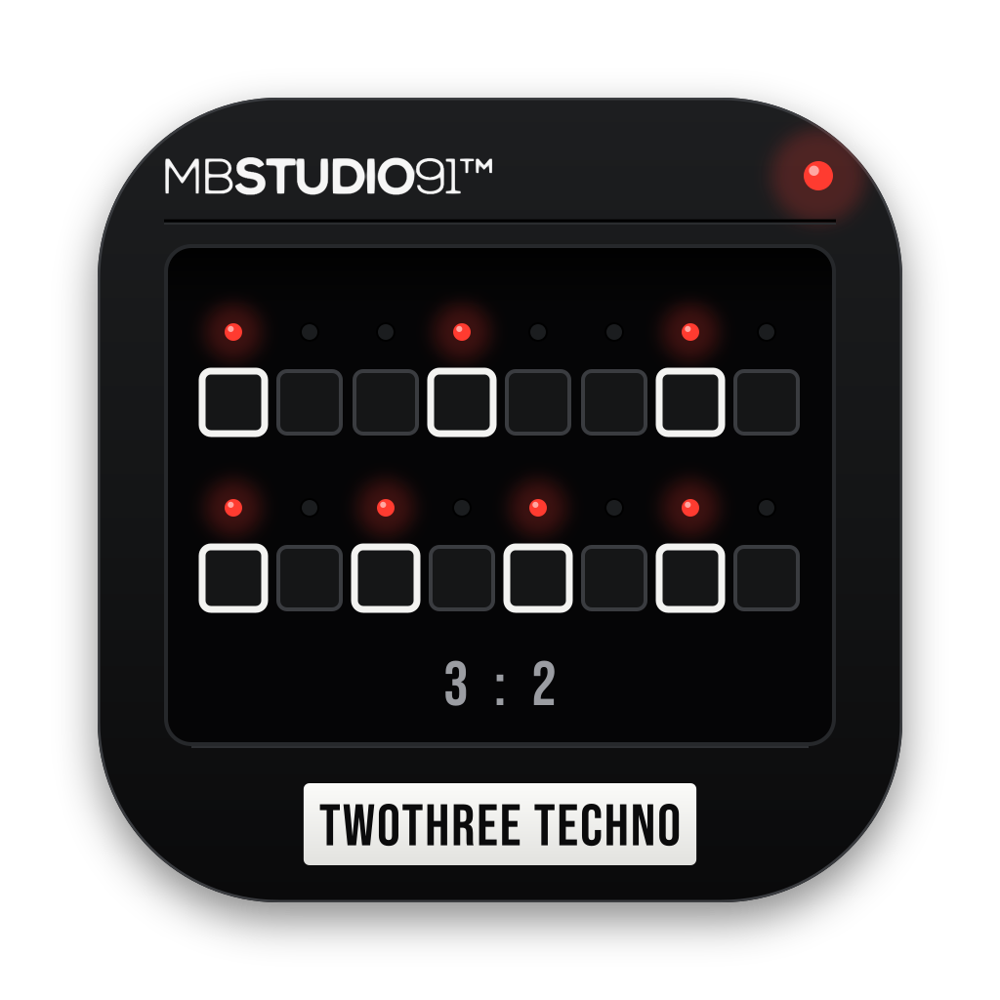

# TwoThree Techno Machine

Drum machine techno nel browser: 16 step per cassa, clap, hat, open, rim, basso acid e due tracce di campioni (Voce e Hit), con il modulo poliritmico 3:2 (emiola) che gira sopra la griglia senza mai riallinearsi del tutto.

Fa parte delle app di MBStudio91 (Piedmont Electronic Sound), con la grafica hardware MBStudio91: telaio nero, serigrafia bianca, LED.

## Provala

Scarica lo zip dall'ultima versione nella pagina **Releases** (a destra in questa pagina), estrailo e apri `index.html` con doppio clic in Chrome, Safari, Edge o Firefox. Funziona anche senza internet: tutto il suono è sintetizzato nel browser.

## Come si usa

- Premi PLAY. Tocca le caselle per accendere gli step; doppio tocco = accento.
- Tocca il nome di una traccia per silenziarla.
- BPM, swing e filtro acid sui cursori; tre pattern di partenza più RANDOM e CLEAR.
- Voce e Hit accettano WAV, MP3, AIFF e M4A, anche trascinati sul riquadro: i file restano nel tuo browser.
- Le note della riga Acid si cambiano tenendo premuto Maiusc o con un tocco lungo.

## File

- `index.html`: l'app completa.
- `icons/`: icona dell'app per Mac (.icns), Windows (.ico), web e iPhone.

## Crediti

- Stile MBStudio91: font Bebas Neue (© Dharma Type) e Antonio (© Vernon Adams), SIL Open Font License 1.1, incorporati nella pagina.
- Codice e grafica © MBStudio91, tutti i diritti riservati.
